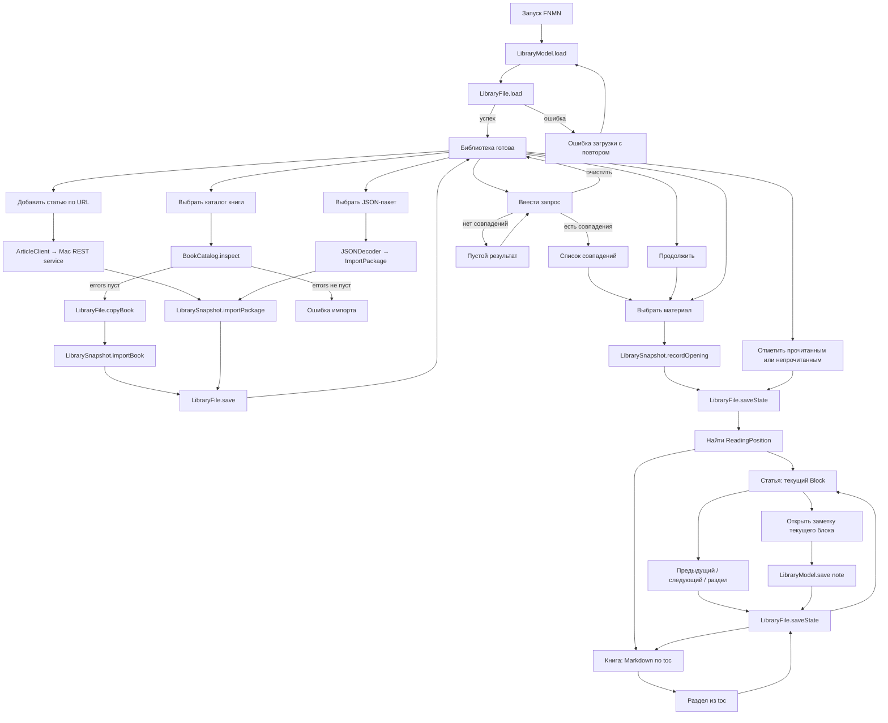
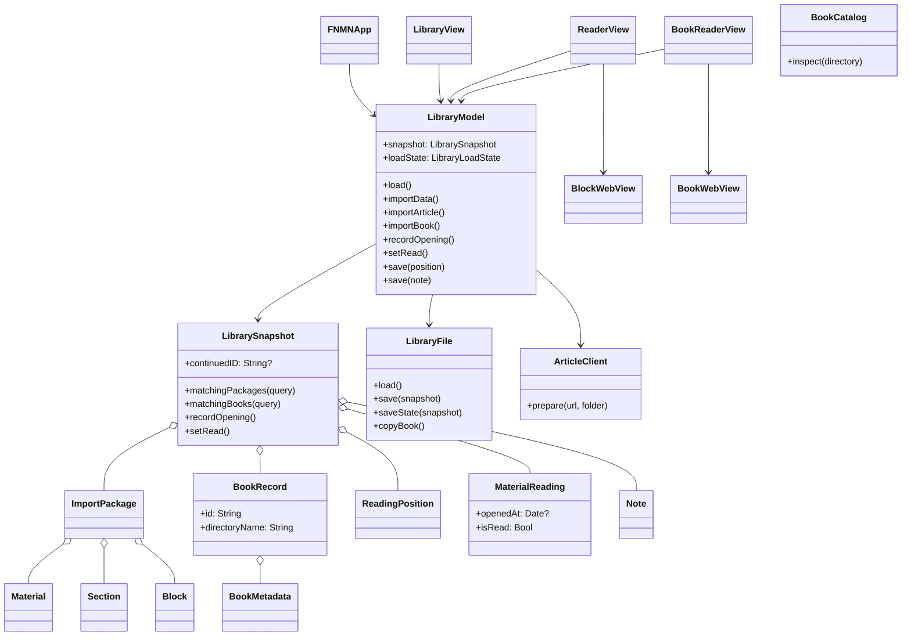
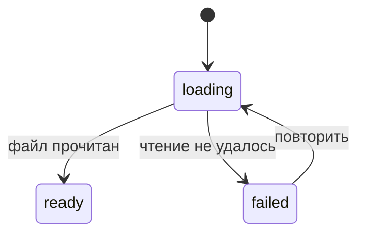
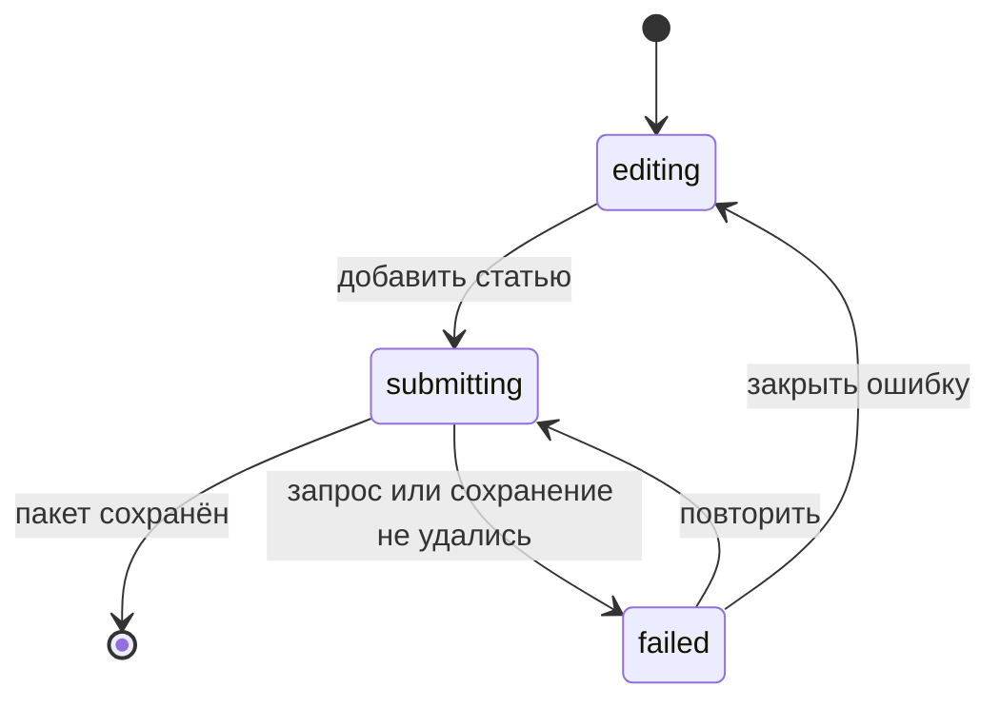
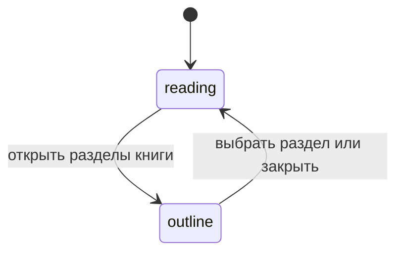
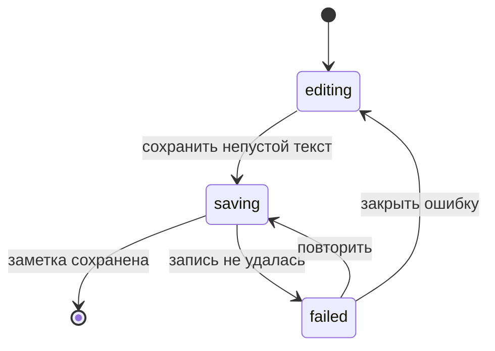
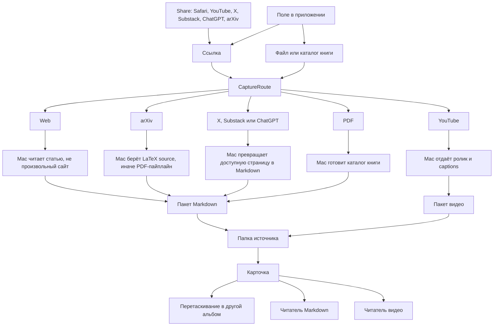
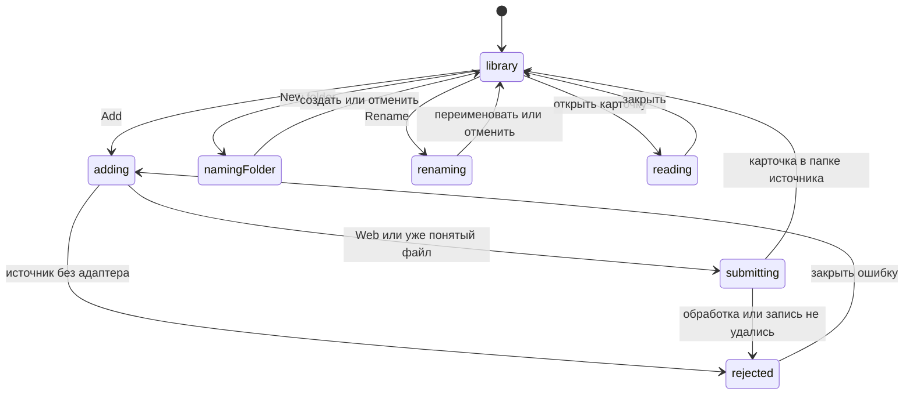

# FNMN: архитектура текущего приложения

Этот файл описывает уже реализуемый срез: локальная библиотека, импорт подготовленного материала, чтение по блокам, восстановление позиции и одна заметка на блок. Перед изменением пользовательского потока сначала меняются схема и состояния здесь, затем код.

## Что доступно пользователю

- Добавить статью по URL через запущенный на Mac сервис.
- Импортировать готовый JSON-пакет статьи или видео.
- Импортировать каталог PDF-книги (`content.md`, `metadata.json`, `assets/`, `validation.json`).
- Открыть статью по блокам или книгу по оглавлению из `metadata.json.toc`.
- Вернуться через «Продолжить» к материалу, который открывали последним, и к его сохранённому блоку; для видео сохранить время текущего блока.
- Явно отметить материал прочитанным или непрочитанным.
- Создать или отредактировать одну заметку у текущего блока.
- Найти статью или книгу по названию, автору, папке или заголовку раздела.
- Создать папку и перетащить в неё материал.
- Открыть исходный URL.

Приложение пока не принимает исходный PDF, DjVu или EPUB напрямую, не ищет по тексту тела документа, не имеет Share Extension и не переносит заметки между изменившимися версиями документа.

## Жизненный цикл



## Владельцы состояния и эффектов



`LibrarySnapshot` — единственный владелец сохранённых данных: JSON-пакеты статей, записи книг, место чтения и `MaterialReading`. Книга хранится каталогом, а не массивом HTML-блоков; оглавление берётся из `metadata.json.toc`. «Продолжить» — селектор `continuedID`: материал с самым поздним `openedAt`; если открытий ещё не записывали, берётся первая статья или книга с сохранённой позицией. Поиск — селектор по уже загруженному снимку: название, автор, папка, URL, заголовки разделов и `toc`; запрос живёт в экране и не пишется на диск. Для книги `ReadingPosition.blockID` — `toc:<ordinal>`. Читатель книги — один `WKWebView` с прокруткой документа, локальным base URL и бандлом Markdown/KaTeX; SwiftUI владеет списком, поиском, оглавлением и действиями. `LibraryFile`, `ArticleClient`, `BlockWebView` и `BookWebView` — границы эффектов.

## Состояния экранов





```mermaid
stateDiagram-v2
    [*] --> reading
    reading --> outline: открыть разделы
    outline --> reading: выбрать раздел или закрыть
    reading --> note: открыть заметку
    note --> reading: сохранить или закрыть
```





Обычные поля формы остаются значениями: URL, токен, папка, черновик заметки и строка поиска. Поиск синхронный, поэтому у него нет фазы ожидания. FSM описывает только допустимую фазу операции. Отдельные `isLoading`, `isSaving`, `showingNote` и `errorMessage`, способные противоречить друг другу, не используются.

## Инварианты

- `ImportPackage.version == 1`, а `blocks` не пуст.
- Книга принимается только при `schema_version == 1` и пустом `validation.json.errors`; отсутствуют `content.md` или файл из `assets/` — ошибка импорта, без частичного чтения.
- Повторный импорт заменяет пакет или книгу с тем же id, не создавая копию.
- Для пары `materialID + blockID` существует не больше одной заметки.
- `ReadingPosition.blockID` указывает на блок статьи или на `toc:<ordinal>` открытой книги; устаревшее время видео не переводит читатель обратно к старому блоку.
- `MaterialReading.openedAt` обновляется при выборе материала; `isRead` меняется только явным действием пользователя и не выводится из позиции или открытия.
- Поиск не меняет снимок: пустой запрос показывает весь список, непустой фильтрует статьи и книги по уже загруженным полям, без чтения `content.md` и HTML блоков.
- Старый `state.json` без `readings` или `books` загружается с пустыми значениями.
- Сначала меняется снимок в памяти, затем он сохраняется атомарно; ошибка записи возвращает прежний снимок.
- Результат асинхронной операции применяется только к экрану и материалу, которые её запустили.

## Захват ссылки или файла

Цель: из меню Share в Safari, YouTube, X, Substack, ChatGPT или arXiv, либо из поля в приложении, ссылка попадает на Mac. Mac возвращает один пакет. У текста это название, автор, ссылка на оригинал и Markdown с LaTeX. У видео это те же название, автор и ссылка, плюс идентификатор ролика и подписи со временем. Папка при создании берётся из источника. Дальше карточку перетаскивают в другие альбомы, как в Photos. Автоматическая классификация тем — отдельная задача, не этот граф.



Сейчас из этого графа исполняется подготовка веб-статьи: Mac по-прежнему возвращает JSON-блоки, не Markdown. Остальные источники узнаются и останавливаются с ошибкой, пока нет их адаптера. Share Extension вызывает тот же вход, что поле в приложении, и не хранит свою копию библиотеки. Приватная страница, которую Mac не может открыть без логина, — ошибка источника, не пустая карточка.



На библиотеке каждое действие куда-то ведёт: поиск фильтрует список и очищается обратно в него; карточка открывает свой читатель; свайп меняет прочитанность; перетаскивание добавляет материал в альбом, не забирая его из прежних; пустой альбом остаётся, чтобы в него можно было бросить карточку; переименование меняет имя альбома у всех его карточек. В добавлении отмена возвращает в библиотеку, ссылка уходит в классификатор, документ выбирается тем же листом. У видео, когда оно появится: портрет показывает подписи под плеером, ландшафт — справа, скрытие убирает текст и возвращает его тем же действием; смена качества и прыжок по подписи остаются внутри этого читателя. Пока видео-читателя нет, ссылка YouTube не открывает пустой экран.

Альбомы принадлежат `LibrarySnapshot`: имя папки и список id материалов. Статья, книга и будущее видео входят в них одним правилом. `CaptureRoute` только называет источник по адресу или расширению. Каждый адаптер Mac — отдельная функция с тем же выходным пакетом. Читателей два вида тела: Markdown и видео; старый блочный читатель остаётся до перевода веб-статей на Markdown.

## Как добавлять следующий срез

До кода в этот файл добавляются видимое действие пользователя, его переходы состояния, владелец данных и граница эффекта. В коде добавляется минимальный сквозной путь через существующие типы. Следующий срез: классификация источника, альбомы для любой карточки и поле добавления. Share Extension, Markdown-пакет и видео — следующие узлы того же графа, без учебной ленты.
