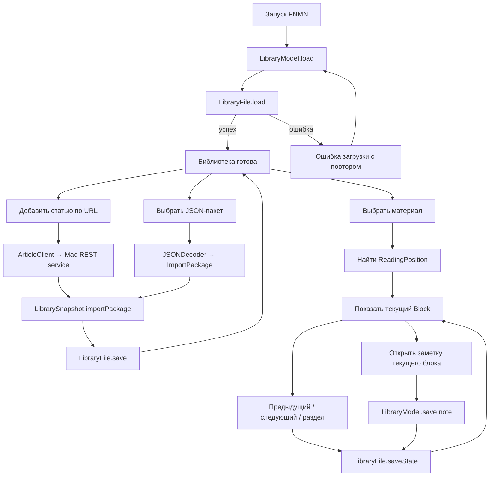
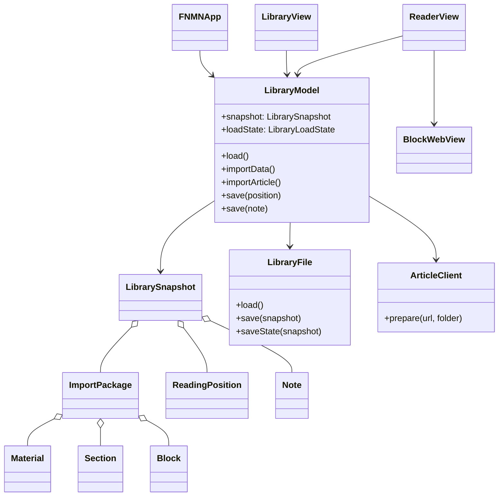
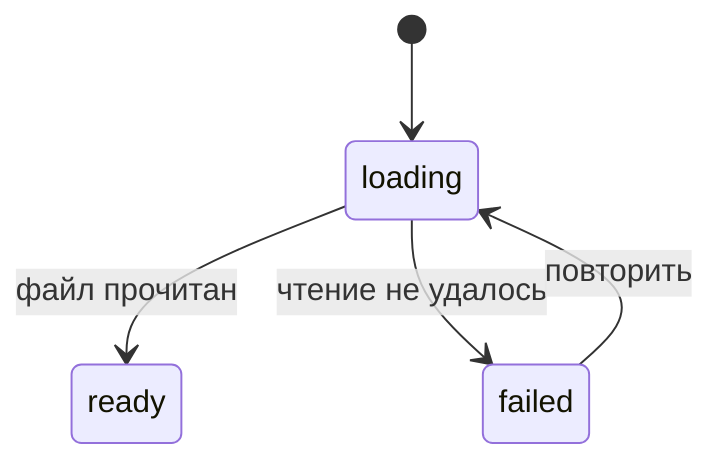
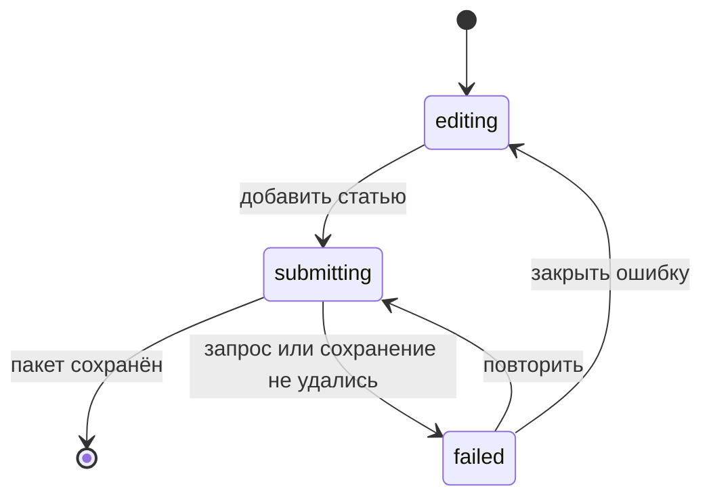
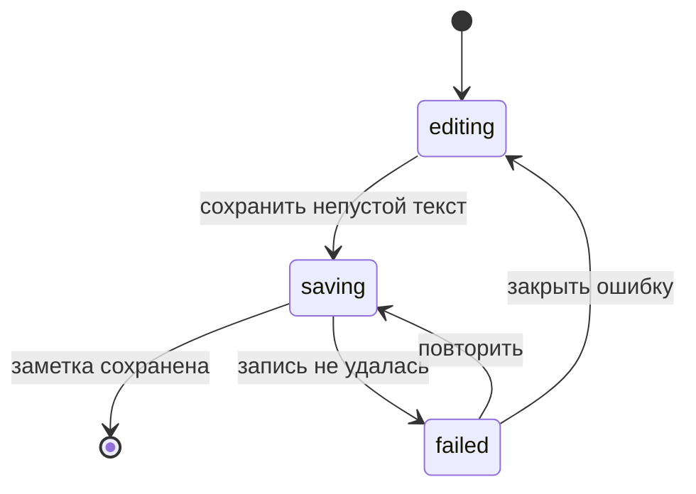

# FNMN: архитектура текущего приложения

Этот файл описывает уже реализуемый срез: локальная библиотека, импорт подготовленного материала, чтение по блокам, восстановление позиции и одна заметка на блок. Перед изменением пользовательского потока сначала меняются схема и состояния здесь, затем код.

## Что доступно пользователю

- Добавить статью по URL через запущенный на Mac сервис.
- Импортировать готовый JSON-пакет статьи или видео.
- Открыть материал, перейти к предыдущему или следующему блоку и выбрать раздел.
- Вернуться к последнему сохранённому блоку; для видео сохранить время текущего блока.
- Создать или отредактировать одну заметку у текущего блока.
- Создать папку и перетащить в неё материал.
- Открыть исходный URL.

Приложение пока не принимает PDF, DjVu или EPUB напрямую, не имеет поиска и Share Extension и не переносит заметки между изменившимися версиями документа.

## Жизненный цикл



## Владельцы состояния и эффектов



`LibrarySnapshot` — единственный владелец сохранённых данных. `LibraryModel` выполняет операции над снимком и вызывает адаптеры. SwiftUI-экраны владеют только временным взаимодействием и отправляют действия в небольшие редьюсеры рядом с экраном. `LibraryFile`, `ArticleClient` и `BlockWebView` — границы эффектов.

## Состояния экранов





```mermaid
stateDiagram-v2
    [*] --> reading
    reading --> outline: открыть разделы
    outline --> reading: выбрать раздел или закрыть
    reading --> note: открыть заметку
    note --> reading: сохранить или закрыть
```



Обычные поля формы остаются значениями: URL, токен, папка и черновик заметки. FSM описывает только допустимую фазу операции. Отдельные `isLoading`, `isSaving`, `showingNote` и `errorMessage`, способные противоречить друг другу, не используются.

## Инварианты

- `ImportPackage.version == 1`, а `blocks` не пуст.
- Повторный импорт заменяет пакет с тем же `material.id`, не создавая копию.
- Для пары `materialID + blockID` существует не больше одной заметки.
- `ReadingPosition.blockID` указывает на блок открытого пакета; устаревшее время видео не переводит читатель обратно к старому блоку.
- Сначала меняется снимок в памяти, затем он сохраняется атомарно; ошибка записи возвращает прежний снимок.
- Результат асинхронной операции применяется только к экрану и материалу, которые её запустили.

## Как добавлять следующий срез

До кода в этот файл добавляются видимое действие пользователя, его переходы состояния, владелец данных и граница эффекта. В коде добавляется минимальный сквозной путь через существующие типы. Следующий срез первого этапа: корректный выбор материала в «Продолжить» и явная отметка прочтения.
