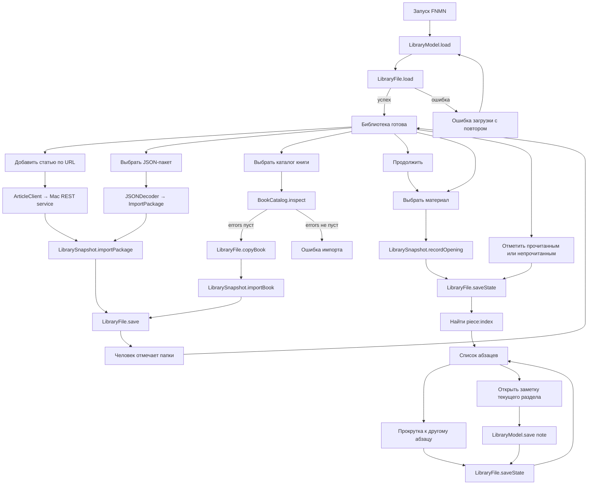
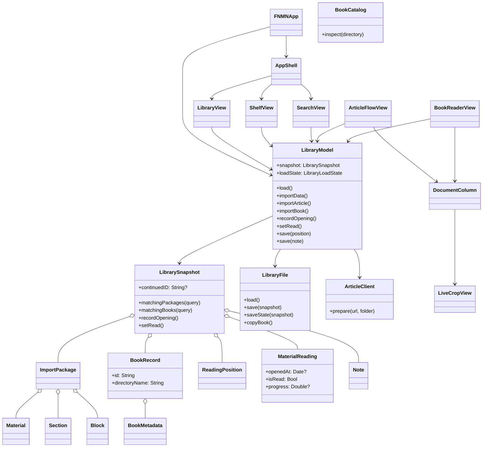
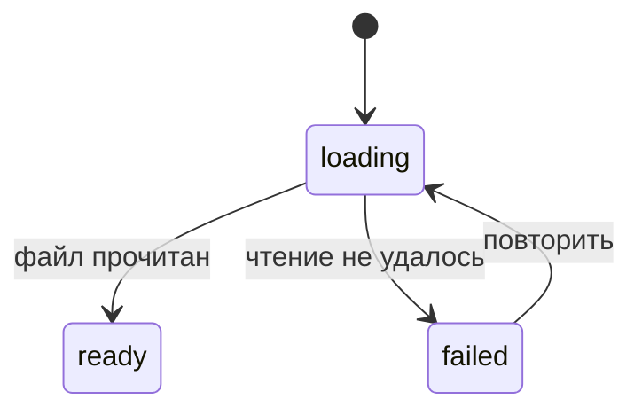
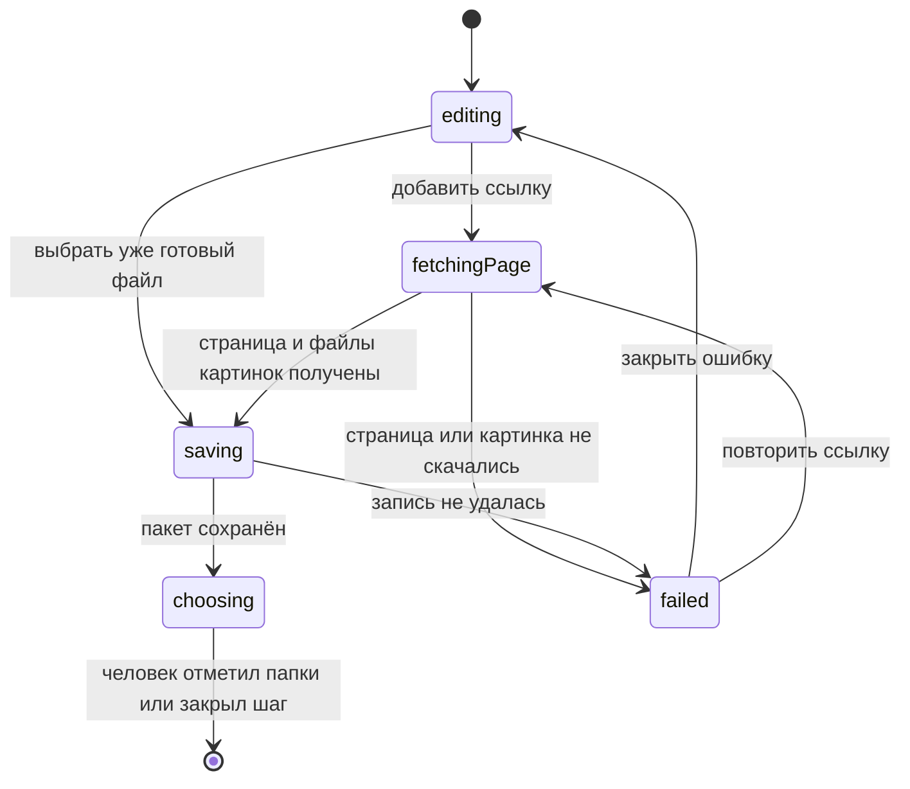
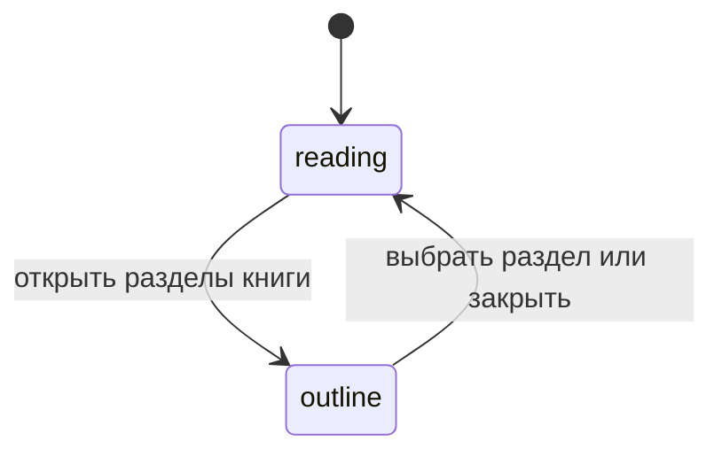
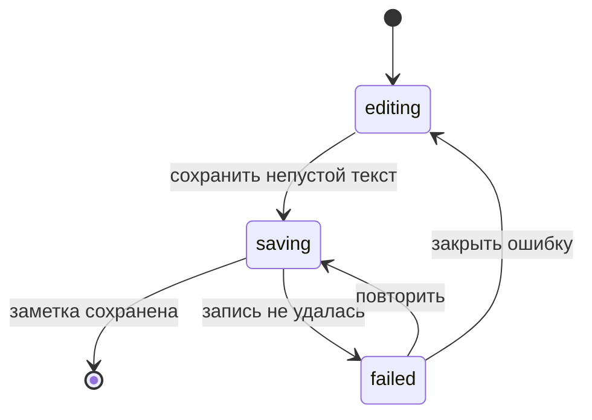
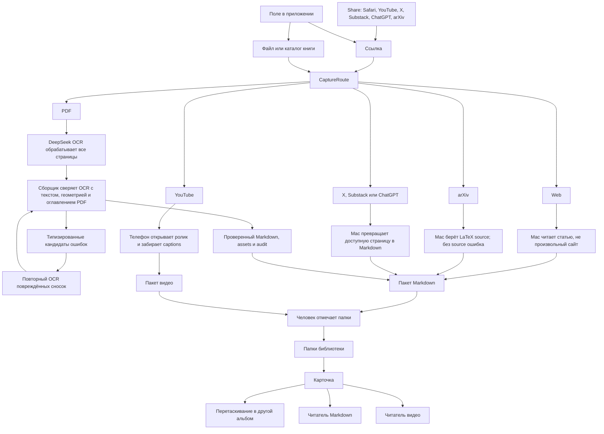
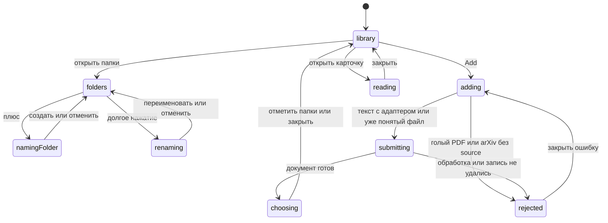

# FNMN: архитектура текущего приложения

Этот файл описывает уже собранный срез: одна библиотека, папки, импорт, список абзацев, место на абзаце, полка и поиск. Перед изменением пользовательского потока сначала меняются схема и состояния здесь, затем код. Схема чтения: [notes/viz/reading.md](notes/viz/reading.md).

## Что доступно пользователю

- Добавить статью по URL через запущенный на Mac сервис.
- Импортировать готовый JSON-пакет статьи или видео.
- Импортировать каталог PDF-книги (`content.md`, `metadata.json`, `assets/`, `validation.json`).
- Открыть статью или книгу списком абзацев. Место чтения это видимый абзац. Оглавление, размер текста и фон открываются из панели навигации.
- Вернуться через «Продолжить» к последнему открытому материалу и к абзацу у верхнего края. Полоска на этой строке показывает долю абзацев.
- Явно отметить материал прочитанным или непрочитанным. Спрятать его в архив и вернуть оттуда.
- Создать или отредактировать одну заметку у раздела, внутри которого остановился абзац.
- Выделить фрагмент абзаца системным меню и подписать его.
- Найти статью или книгу на вкладке поиска по названию, автору, папке или заголовку раздела.
- Добавить ссылку или документ: прогресс на экране и в Live Activity, экран можно закрыть. Когда документ готов, человек отмечает одну или несколько папок.
- Увидеть понятную остановку, если источник узнан, но Mac его ещё не готовит.
- Создать альбом, переименовать его и перетащить в него статью или книгу, не забирая карточку из других альбомов.
- Открыть исходный URL.
- Передать ссылку из Share в то же добавление.

Приложение пока не принимает исходный PDF, DjVu или EPUB напрямую, не ищет по тексту тела документа и не переносит заметки и выделения между изменившимися версиями документа.

## Жизненный цикл



## Владельцы состояния и эффектов



`LibrarySnapshot` — единственный владелец сохранённых данных: JSON-пакеты статей, записи книг, место чтения, `MaterialReading`, заметки, выделения, архив и папки. Книга хранится каталогом, а не массивом HTML-блоков; оглавление берётся из `metadata.json.toc`. «Продолжить» — селектор `continuedID`: неархивный материал с самым поздним `openedAt`; если открытий ещё не записывали, берётся первая статья или книга с сохранённой позицией. Поиск живёт на вкладке поиска и не пишется на диск: пустой запрос показывает подсказку, непустой фильтрует статьи и книги по уже загруженным полям, без чтения `content.md`. Текущее место — `piece:<index>` видимого абзаца. Старые `toc:<ordinal>` и id блока ещё открывают соответствующий абзац. `progress` — доля абзацев до этого места включительно. `LibraryFile` и `ArticleClient` — границы эффектов диска и Mac. `ImportActivity` — граница Live Activity. `LiveCropView` — единственный web view чтения: живой кадр фигуры.

## Состояния экранов





```mermaid
stateDiagram-v2
    [*] --> reading
    reading --> outline: открыть разделы
    outline --> reading: выбрать раздел или закрыть
    reading --> note: открыть заметку
    note --> reading: сохранить или закрыть
```





Обычные поля формы остаются значениями: URL, токен, папка, черновик заметки и строка поиска. Поиск синхронный, поэтому у него нет фазы ожидания. FSM описывает только допустимую фазу операции. Отдельные `isLoading`, `isSaving`, `showingNote` и `errorMessage`, способные противоречить друг другу, не используются.

## Инварианты

- `ImportPackage.version == 1`, а `blocks` не пуст.
- Книга принимается только при `schema_version == 1` и пустом `validation.json.errors`; отсутствуют `content.md` или файл из `assets/` — ошибка импорта, без частичного чтения.
- Повторный импорт заменяет пакет или книгу с тем же id, не создавая копию.
- Для пары `materialID + piece` существует не больше одной пометки: выделение, зачёркивание и подпись — поля одной записи. Старые `Note` по `blockID` ещё читаются и видны на полке, новые не пишутся.
- Новое `ReadingPosition.blockID` имеет вид `piece:<index>`. Старые `toc:<ordinal>` и id блока при открытии переводятся в абзац и не возвращают читатель к web view.
- `MaterialReading.openedAt` обновляется при выборе материала. `isRead` и архив меняются только явным действием. `progress` пишется вместе с местом и не отмечает материал прочитанным.
- Поиск не меняет снимок: пустой запрос показывает весь список, непустой фильтрует статьи и книги по уже загруженным полям, без чтения `content.md` и HTML блоков.
- Карточка может лежать в нескольких альбомах. Переименование альбома меняет это имя у всех его карточек. Старый `state.json` без `placements` восстанавливает альбомы из папок пакета.
- Старый `state.json` без `readings`, `books`, `highlights` или `archived` загружается с пустыми значениями.
- Сначала меняется снимок в памяти, затем он сохраняется атомарно; ошибка записи возвращает прежний снимок.
- Результат асинхронной операции применяется только к экрану и материалу, которые её запустили.

## Захват ссылки или файла

Цель: из меню Share в Safari, YouTube, X, Substack, ChatGPT или arXiv, либо из поля в приложении, ссылка попадает в один вход. Текст уходит на сервер, который возвращает пакет: название, автор, ссылка на оригинал и Markdown с LaTeX. YouTube сервер не готовит: телефон сам открывает ролик и, если публичная страница их отдаёт, забирает название и подписи со временем. Папку после подготовки отмечает человек, одну или несколько. Дальше карточку перетаскивают в другие альбомы, как в Photos. Автоматическая классификация тем — отдельная задача, не этот граф.



Сейчас из этого графа исполняются поле добавления, классификация, альбомы и передача ссылки из Share. Share открывает приложение на том же листе добавления и не хранит свою библиотеку. Веб-статья и страница Substack идут через разбор статьи. Пост X, публичный share ChatGPT и arXiv с LaTeX source приходят тем же Markdown-пакетом. Книжный каталог копируется как книга. Папку после этого отмечает человек, одну или несколько. YouTube собирается на телефоне и открывает плеер. Ссылка на голый PDF и arXiv без source узнаются и останавливаются: PDF ещё не запускает пайплайн книги. Приватная страница, которую сервер не может открыть без логина, — ошибка источника, не пустая карточка.



На библиотеке каждое действие куда-то ведёт: карточка открывает свой читатель; свайп меняет прочитанность; контекстное меню прячет материал в архив; перетаскивание добавляет материал в альбом, не забирая его из прежних; пустой альбом остаётся, чтобы в него можно было бросить карточку; переименование меняет имя альбома у всех его карточек. Поиск живёт на своей вкладке. В добавлении закрытие во время прогресса оставляет Live Activity, ссылка уходит в классификатор, готовый документ ждёт отмеченных папок. У видео портрет показывает подписи под плеером, ландшафт — справа, скрытие убирает текст и возвращает его тем же действием. Прыжок по подписи остаётся внутри этого читателя. Переключатель качества не обещан.

Альбомы принадлежат `LibrarySnapshot`: имя папки и список id материалов. Статья, книга и видео входят в них одним правилом. `CaptureRoute` только называет источник по адресу или расширению. Текстовый адаптер сервера — отдельная функция на источник. Текстовый выход один: Markdown с `$...$`, `$$...$$`, файлами картинок и видео и блоками `fnmn-interactive`. Его читает один список абзацев. Текст, формулы, картинки и обычное видео рисуются нативно. Формула, которую SwiftMath не разобрал, остаётся исходным LaTeX. Живой кадр открывает исходный адрес и скрывает соседей. Пакет без `body` собирает текст из блоков и идёт в тот же список. Видео с подписями собирает телефон и открывает отдельный плеер, не второй текстовый читатель. Shelf показывает одну пометку двумя фильтрами: подпись и выделение, плюс явно прочитанное, материалы с `progress` не ниже 0.9 и архив.

## Как добавлять следующий срез

До кода в этот файл добавляются видимое действие пользователя, его переходы состояния, владелец данных и граница эффекта. В коде добавляется минимальный сквозной путь через существующие типы. Следующий источник с тем же Markdown — PDF arXiv через пайплайн книги. YouTube остаётся пакетом видео, который собирает телефон.
