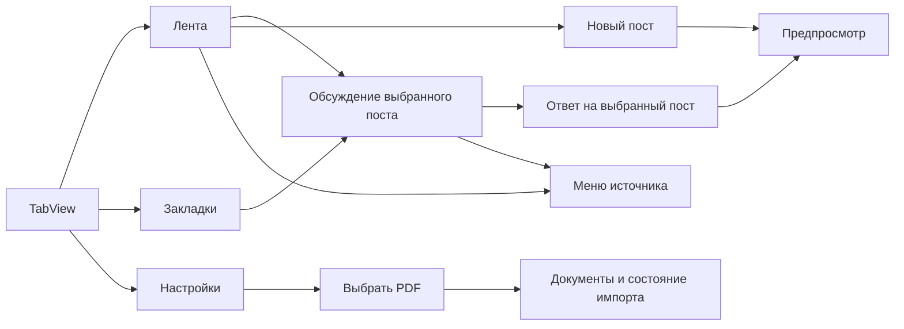
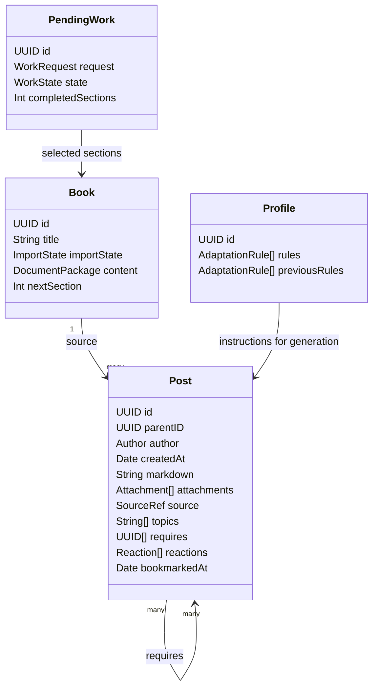
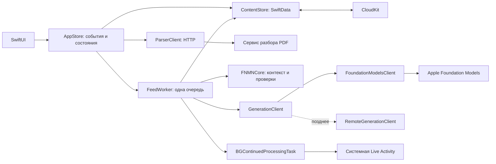
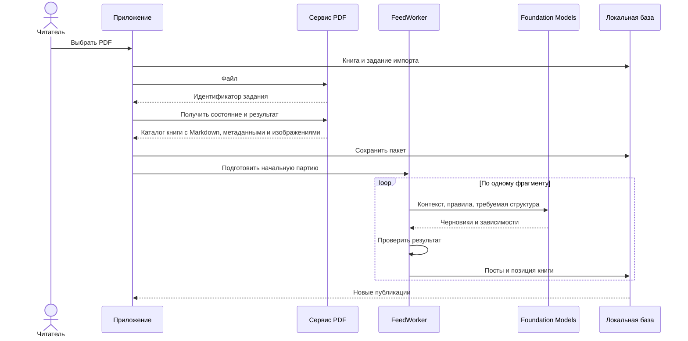
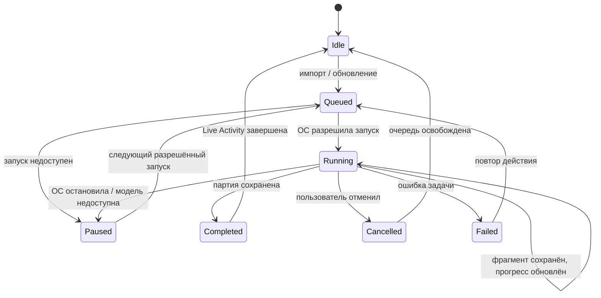

# FNMN: учебная лента

Статус: отложенная будущая разработка. Лента, посты, закладки постов, генерация и переписывание учебных материалов, реакции и адаптация не входят в текущий этап. Сейчас проектируется и доводится библиотека и просмотрщик файлов: навигация, поиск, добавление, чтение и связь с Mac. Текущий интерфейс описан в [APP_SPEC.md](APP_SPEC.md), проект его экранов — в [notes/design/library-ui.md](notes/design/library-ui.md), порядок работ — в [notes/plan.md](notes/plan.md) и [notes/tasks.md](notes/tasks.md). Описанные ниже модели и интерфейсы относятся только к будущей ленте. Исследования: [Apple](notes/research/apple-stack.md), [рендеринг](notes/research/rendering.md), [знания](notes/research/knowledge.md), [адаптация](notes/research/adaptation.md).

## 1. Продукт

Приватная лента коротких объяснений из книг, которую можно долго листать вместо Twitter. Один пост содержит одну мысль. Ответ является таким же постом, связанным с родителем. Пользователь пишет, отвечает, ставит реакции и сохраняет посты. Система автоматически готовит новые объяснения и учитывает замечания.

Платформа ленты: iPhone и iPad, английский контент, Apple Foundation Models. Минимальная версия ОС уточняется в едином плане. PDF выбирается на телефоне и разбирается сервером. Посты и результат разбора хранятся локально, синхронизация через CloudKit. Выбор провайдера и его настройки являются конфигурацией исполнителя.

### Состав интерфейса

| Поверхность | Содержание и действия |
|---|---|
| Лента | Хронологические посты, поиск, обновление, публикация своего поста |
| Закладки | Сохранённые посты, отдельный поиск, переход в обсуждение |
| Настройки | Личные параметры, документы, импорт PDF, состояния импорта |
| Обсуждение | Цепочка предков выбранного поста и ответы; действие ответа у каждого поста |
| Редактор | Системный TextEditor для Markdown, предпросмотр формул, публикация |
| Меню источника | Книга, раздел и имеющиеся ссылки за системной иконкой |

TabView, NavigationStack, List, toolbar, sheet, Menu, Button, TextEditor и SF Symbols задают форму интерфейса. Контент выровнен по общей вертикали, без карточек и вымышленных аватаров. Liquid Glass используется стандартными элементами управления; тело поста остаётся текстом. На iPad компоновка адаптируется системными средствами. Веб-слой отображает Markdown, формулы и вложения, но не рисует навигацию приложения.

## 2. Один пост, несколько представлений

`parentID` задаёт ответ. Корень треда вычисляется по цепочке родителей. Ответ пользователя и ответ модели одинаково сохраняются и попадают в общую ленту. Полноценной отдельной сущности комментария или треда не требуется.

В общей ленте сортировка идёт по времени публикации, новые сверху; идентификатор разрешает равенство времён. В обсуждении предки показываются от корня к выбранному посту, под ним непосредственные ответы. Нажатие на ответ продолжает эту ветку. У ответа в общей ленте видна короткая строка контекста родителя; переход открывает всю цепочку.

Новый собственный пост появляется сверху сразу после локального сохранения. Если новые ответы приходят, пока человек читает историю ниже, позиция не скачет: стандартная кнопка в toolbar сообщает о новых постах и позволяет перейти вверх. Обновление объединяет новые локальные и синхронизированные записи, затем запрашивает пополнение.

Хронология не равна порядку изучения. Поздняя часть треда может оказаться выше начала. Поэтому пост сохраняет необходимое короткое пояснение, а переход «Начало треда» открывает предпосылки. Внутренняя зависимость влияет на подготовку материала, а не переставляет старые публикации.

### Реакции

Предложение для компактного интерфейса: обычные кнопки положительной реакции, ответа и закладки; остальные реакции в стандартном Menu: «Знаю», «Не знаю», «Непонятно», «Скучно». Названия локализуются. Повторное нажатие снимает реакцию. «Знаю» и «Не знаю» взаимно исключаются, положительная оценка и остальные сигналы могут сосуществовать.

Реакция записывается на конкретный пост. Она влияет на следующую подготовку; опубликованный текст не переписывается автоматически. Замечание вроде «откуда взялся этот член» остаётся ответом пользователя и может получить поясняющий ответ модели.

## 3. Данные

Четыре хранимые сущности: книга, пост, профиль и незавершённая задача. Остальные типы ниже являются вложенными значениями, а не самостоятельными таблицами. Поля перечислены только для текущих операций.

`parentID`, `source` и `bookmarkedAt` необязательны. Автор имеет роли `user` и `assistant`, без отдельного каталога персонажей. `SourceRef` содержит книгу и раздел; координаты PDF не обязательны. `DocumentPackage` содержит разделы Markdown и связанные ресурсы. Каждый раздел имеет устойчивый идентификатор внутри пакета. Готовый пакет неизменяем: повторная доставка того же результата относится к той же книге, другое содержимое получает другой идентификатор книги.

Для PDF-книги `DocumentPackage` имеет файловый контракт версии 1: `content.md`, `metadata.json`, `assets/` и `validation.json`. Метаданные содержат название, подзаголовок, авторов, участников, язык, относительные пути и упорядоченный `toc`; каждая запись оглавления задаёт свой номер, уровень Markdown и отображаемый заголовок. `content.md` хранит исходный Markdown и LaTeX, включая References, фигуры и Markdown-сноски. В нём нет печатного Contents, Index, PDF-маркеров страниц, числовых префиксов заголовков и тройных пустых строк. Импорт принимает пакет только с пустым `validation.json.errors`, копирует его целиком и разрешает изображения относительно `assets/`. Читатель получает название и авторов из метаданных, навигацию из `toc`, а сноски показывает ссылкой или popover. Экспортёр и проверочный образец находятся в `mac/pdf-book/` и `fixtures/books/principles-of-deep-learning-theory/`.

Предложение для первого опыта: пакет разделов и изображений хранится единым бинарным значением с SwiftData externalStorage. Распакованные файлы являются восстанавливаемым локальным кэшем, ссылки внутри пакета относительные. Книга становится ready после получения и проверки целого пакета. На втором устройстве отсутствие пакета означает загрузку, даже если метаданные уже пришли. Такой простой формат требует повторной передачи целого пакета при новом импорте; его пригодность для размеров выбранной книги проверяется до фиксации схемы. Оригинальный PDF сохраняется на импортировавшем устройстве; синхронизация оригинала в этот контракт не включена.

`PendingWork` нужен, чтобы продолжить остановленную партию и не опубликовать её второй раз. Идентификаторы создаваемых постов резервируются до записи результата; повторное применение одного результата сохраняет те же записи. Завершённое задание освобождается после сохранения результата. История постов не версионируется.

### Внутренний граф

В MVP узел знания совпадает с постом, который объясняет единицу исходного материала. `requires` означает «для этого объяснения нужна мысль из указанного поста». `parentID` относится к разговору и не доказывает смысловую зависимость. Тема хранится меткой; отдельная глобальная шкала сложности пока не нужна.

Модель предлагает локальные зависимости между уже существующими постами и текущими черновиками. Приложение проверяет наличие узлов, отсутствие ссылок на себя и циклов. Эти проверки обеспечивают целостность структуры, но не правильность педагогического решения. Взаимодействия пользователя остаются исходными свидетельствами; «показано», «понравилось» и «заявлено знакомым» не объединяются в один уровень освоения.

## 4. Исполнитель

Первый путь разделён по месту работы: сервер разбирает PDF, iPhone генерирует посты. Swift-код, который собирает контекст и обрабатывает результат, не зависит от SwiftUI. Замена локальной генерации серверной происходит на границе `GenerationClient`, а не в экранных компонентах.

| Тип / файл | Ответственность |
|---|---|
| `AppStore.swift` | Состояние вкладки, маршрута, редактора и загрузки; обработка пользовательских событий |
| `ContentStore.swift` | Локальное чтение страниц постов, поиск и запись результатов одним владельцем SwiftData-контекста |
| `FeedWorker.swift` | Последовательное исполнение заданий, отмена, сохранение частичного результата и пополнение |
| `GenerationClient.swift` | Небольшой контракт входа и результата; локальный Foundation Models в первой реализации |
| `FNMNCore/` | Codable-значения запроса и черновика, сборка инструкций, проверки ссылок и зависимостей |
| `ParserClient.swift` | Загрузка PDF, состояние удалённого разбора, получение и проверка каталога книги |
| `PostBody.swift` и локальный веб-пакет | Измеряемое тело поста с Markdown, LaTeX и изображениями |

Это карта будущего кода, перечисленные файлы пока не созданы. Состояния задаются Swift enum, вычисляемые списки и счётчики не дублируются в самостоятельных моделях. IO находится в исполнителях и хранилище; проверки данных являются обычными функциями.

Контракт генерации: `run(request) async throws -> result`. Запрос содержит вид работы, нужный фрагмент, небольшой контекст обсуждения и относящиеся к нему инструкции. Результат содержит черновики постов и предложенные изменения зависимостей или правил. Модель не получает произвольный доступ к базе. Инструменты дают прочитать раздел, контекст поста и связанные понятия; публикация выполняется приложением после проверки.

На Linux может работать общая Swift-логика, но Foundation Models требует платформу Apple. Серверная генерация позднее использует другой модельный адаптер. Сервис разбора возвращает результат клиенту, не пишет напрямую в частную SwiftData-базу CloudKit.

## 5. Из параграфа в партию постов

1. **Взять контекст.** Параграф является начальной единицей работы. Сохраняются необходимые определения, обозначения и формулы соседнего текста. Если контекст не помещается, разделить работу по смыслу; не обрезать условия по числу символов.
2. **Выделить мысли.** Для каждой мысли указать исходный фрагмент, необходимые термины и причину перехода. Предложение не считается атомарным автоматически. Первая проверка проводится на одном параграфе.
3. **Подготовить объяснение.** Один пост раскрывает одну мысль. Формула вводится через наблюдение и требуемое действие, каждый новый член получает объяснение. Составная задача разбивается на вопросы с коротким умственным действием.
4. **Сопоставить с исходником.** Проверить наличие опоры, сохранность условий и формул, неусиление утверждения, явность переходов. Структурные проверки выполняет код, смысловую оценку предлагает модель. Непрошедший материал остаётся черновиком.
5. **Сохранить результат.** Публикации, связи и сдвиг позиции книги записываются вместе. После этого они доступны без сети. Готовый текст не зависит от продолжения текущей модельной сессии.

Стартовая политика для одного документа: последовательно обрабатывать разделы и готовить конечные партии. Размер партии выбирается после измерения времени и контекста, а не задаётся здесь произвольной константой. Несколько книг автоматически дают кандидатов для следующей партии; точная доля тем требует выбора по результатам первого опыта. Ранжирование не изменяет порядок уже опубликованной истории.

Если импорт завершился, когда приложение уже приостановлено, генерация ждёт разрешённого исполнения. Передача файла, серверный разбор и локальная генерация имеют независимые состояния; Live Activity не заставляет все три операции исполниться немедленно.

## 6. Обучение подаче по комментариям

Базовая инструкция закреплена приложением: раскрывать термины и формулы через первые принципы, сохранять условия исходника, различать источник и добавленное пояснение. При подготовке поста к ней добавляются подходящие замечания и короткие примеры пользователя.

После подробного комментария та же модель в отдельной короткой задаче предлагает узкое правило: что изменить, к какому случаю оно относится, какой комментарий послужил основанием. Приложение проверяет форму и границы изменения. Правило для текущего разговора может действовать сразу; расширение на другие темы требует проверки на независимых примерах. Пользователь взаимодействует через обычные ответы, без подтверждения каждого правила.

| Кто | Что решает |
|---|---|
| Пользователь | Даёт содержательное замечание или реакцию обычным действием в ленте |
| Модель-обновитель | Предлагает трактовку замечания и ограниченную инструкцию с примером |
| Код приложения | Проверяет ссылки, допустимые поля и неизменность базовых требований; сохраняет или отклоняет структуру изменения |
| Оценка объяснения | Сравнивает смысл и подачу на примерах; требует отдельной проверки качества, не гарантируется JSON-схемой |
| Генератор | Использует действующие правила при следующей подготовке |

Одна конкретная коррекция достаточна для локального изменения. Для вывода «это улучшает все объяснения» заранее заданного достаточного числа лайков нет. Голые реакции влияют на выбор материала и примеров, но не порождают выдуманную причину вроде «скучно, значит знает доказательство».

Изменяются текстовые инструкции и небольшой набор примеров. Исполняемый код приложения остаётся фиксированным. Предыдущий набор правил хранится внутренне для восстановления при неудачном изменении; это не версии публикаций. Глобальный поиск инструкций и A/B-эксперименты относятся к дальнейшей проверке механизма.

## 7. Фон и Live Activity

Импорт и обновление ленты являются пользовательскими действиями, от которых можно начать конечную BGContinuedProcessingTask. Система показывает её Live Activity с числом обработанных фрагментов и возможностью отмены. Продолжение после сворачивания зависит от ОС. Поддержку фонового исполнения именно Foundation Models и требуемых ресурсов нужно проверить на iPhone до обещания стабильной работы. [Основание](notes/research/apple-stack.md#live-activity-и-длительная-подготовка).

Принудительное закрытие может обойти обработчик отмены. При следующем запуске незавершённое задание распознаётся по сохранённой позиции, а не по обещанию получить финальный callback. Отмена Live Activity останавливает остаток партии, готовые посты остаются.

Автоматическое пополнение во время чтения работает в активном приложении. Фоновое продолжение без явного действия использует только разрешённые системой окна. Ежедневный автономный запуск и случайное время ответа не входят в гарантии первой версии.

## 8. Состояния интерфейса

Таблица задаёт все различимые состояния текущего MVP. Независимые процессы, например синхронизация и чтение, не умножаются в общий гигантский enum.

| Область | Состояния | Видимое поведение |
|---|---|---|
| Лента | initialLoading, empty, ready, failed | Системный ProgressView, предложение импортировать книгу, посты либо повтор чтения |
| Пополнение | idle, queued, running, paused, failed | Старые посты остаются; состояние подготовки показывается компактно, в фоне через системную Live Activity |
| История | idle, loading, exhausted, failed | Нижний индикатор, подгруженные посты, конец сохранённого материала либо повтор |
| Новые посты | нет / есть за пределами текущей позиции | Позиция чтения стабильна; стандартное действие перехода к новым |
| Поиск | emptyQuery, searching, results, noResults, failed | Пустой запрос возвращает исходный список; лента и закладки имеют разные области поиска |
| Закладки | empty, ready | Системное пустое состояние либо сохранённые посты |
| Обсуждение | loading, ready, parentPending, unavailable | Предки и ответы; при задержке синхронизации родителя доступен сам ответ |
| Редактор | editing, previewing, saving, failed | Черновик сохраняется при ошибке; повтор не создаёт второй пост |
| Ответ модели | queued, generating, posted, skipped, failed | Опубликованный ответ появляется в треде и ленте; при skipped не добавляется пустой пост |
| PDF | selected, uploading, processing, downloading, ready, failed | Состояние видно у документа; отмена выбора закрывает системный picker без создания книги |
| Тело поста | rendering, ready, unsupportedMath, missingAsset | Неисчезающий текст; неподдержанная формула доступна как исходник, отсутствующее вложение можно загрузить повторно |
| Синхронизация | available, pending, unavailable | Локальная лента читается; состояние iCloud не блокирует своё сохранение |

Повторное событие завершения применяется по идентификатору запроса. Устаревший результат поиска не заменяет новый. При закрытии редактора с текстом предлагается системное подтверждение потери черновика; публикация фиксируется только после успешной локальной записи.

## 9. Рендеринг

Предлагаемый минимум: локальные markdown-it, markdown-it-texmath и KaTeX в WKWebView. Математические блоки выделяются до обычной Markdown-нормализации, иначе можно потерять обратные слеши или подчёркивания. Mermaid добавляется как обработчик соответствующего блока. Все версии фиксируются после проверки корпуса. [Сравнение и опыт Ctrl](notes/research/rendering.md).

HTML владеет телом поста. SwiftUI владеет кнопками, меню, вводом и прокруткой списка. WKWebView не прокручивается самостоятельно и сообщает высоту после загрузки формул, шрифтов и изображений. Основной текст использует системную типографику; специальные математические шрифты поставляет рендерер формул.

Вложения из пакета доступны без сети. Формулы и ресурсы не загружаются с CDN. Произвольный HTML от модели изолируется отдельно, без доступа к базе и инструментам. Для первой интерактивной вставки предпочтительны рисунок и данные, которыми управляют нативные Slider/Button. Созданный моделью JavaScript не становится доверенным кодом приложения.

Очень широкая формула не обрезается молча. Сначала используется математически допустимая многострочная запись; если она не помещается, доступен полноэкранный просмотр. Автоматически менять смысл или уменьшать текст до нечитаемого размера нельзя. Точное поведение требуется проверить на узком iPhone.

KaTeX и MathJax поддерживают конечные подмножества TeX. Поддержку нужных окружений и пользовательских макросов определяет тест реальной книги. Если KaTeX не покрывает корпус, MathJax рассматривается как замена до фиксации рендерера, с проверкой скорости и памяти.

## 10. Проверка до расширения

| Шаг | Проверяемое свойство | Граница |
|---|---|---|
| Платформенный опыт | Foundation Models завершает короткую задачу после сворачивания через BGContinuedProcessingTask; отмена сохраняет результат | Сначала искусственный короткий текст, не книга |
| Импорт | Один выбранный PDF даёт локальный каталог с проверенными метаданными, Markdown, формулами и реальными картинками | Пакет `fixtures/books/principles-of-deep-learning-theory/` проходит структурную проверку; семантическую точность книги проверяет человек |
| Один параграф | Одна мысль на пост, определения и условия сохранены, каждый переход объяснён | Сравнение с исходным фрагментом человеком |
| Рендеринг | Формулы, изображения, выделение и размер текста на iPhone/iPad | Ошибки TeX не скрываются пустым местом |
| Разговор | Свой пост и ответ появляются в обеих проекциях, связь с родителем сохраняется | Повтор сохранения и задержка синхронизации |
| Адаптация | Конкретное замечание меняет следующий ответ по существу | Пара старое/новое и случай, где правило неприменимо |
| Накопленная лента | Подгрузка истории, поиск и возврат к позиции при поступлении новых постов | Проверка времени кадров и памяти с веб-телами |
| CloudKit | Посты и вложения доходят до второго устройства; локальное чтение работает без сети | Конфликты и одновременная генерация проверяются отдельно |

Назначенная книга и граница запуска записаны в [требованиях](notes/state/fnmn.md#будущая-проверка). Метрики скорости и качества пока не измерены.

## 11. Открытые решения

- Размещение и авторизация сервиса PDF; формат задания уже отделён от интерфейса.
- Размер партии и способ смешения книг после первого опыта; произвольные веса тем не зафиксированы.
- Условия автоматического ответа модели и его задержки. Первый опыт может отвечать на каждый адресованный вопрос; это предложение, а не установленная политика.
- Генерация с двух устройств: необходим один владелец активного задания либо координация сервером. CloudKit сам не выдаёт эксклюзивную блокировку.
- Конкретное поведение фоновой Foundation Models, покрытие формул и транспорт крупных вложений подтверждаются платформенными проверками перед основной реализацией.

Первая проверка при переходе к генерации ленты: короткая задача Foundation Models с системной Live Activity и сохранением результата. Начальная реализация библиотеки и читателя определяется [единым планом](notes/plan.md#порядок-разработки).

## 12. Стоимость серверной альтернативы

Для условной книги на 500 страниц Mistral OCR стоит $2 по опубликованному тарифу. Иллюстративные 1.5 млн входных и 0.75 млн выходных токенов через DeepSeek Flash добавляют $0.675–1.35 в зависимости от времени запроса. Фактический объём токенов и повторов ещё не измерен. [Расчёт, надёжность и оплата](notes/research/costs.md).

Управляемый OCR API предлагается проверить как реализацию сервиса разбора до развёртывания собственного GPU. Проверка облачной модели для объяснений является отдельным будущим решением; MVP сохраняет выбранные Foundation Models и английский язык. Точная передача формул подтверждается сравнением с исходными страницами, а не стоимостью или названием модели.
