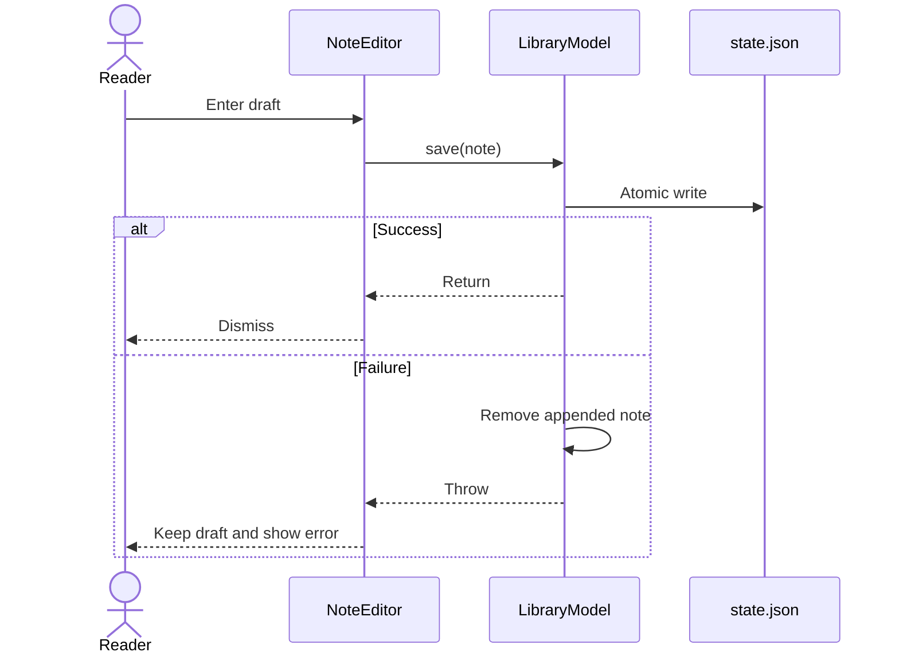

# Implementation round: note save failure

## Starting defects from the first layer

- `mac/fnmn_service.py` originally emitted nested MathML twice because the XPath visited both the enclosing paragraph and its `<math>` descendant. The parser now skips descendants of `p`, and `mac/tests/test_service.py` checks for one formula block and one `<mi>x</mi>` occurrence. A parser test that asserted only `formula in kinds` missed the duplicate.
- `LibraryModel` mutates memory before writing `state.json`. The first layer did not consistently restore the previous value when the write failed. Current import, move, position, video time, and note paths roll back their own mutation.
- `NoteEditor` dismissed after every save attempt because `LibraryModel.save(note:)` returned no result. When `LibraryFile.saveState` failed, the model removed the unsaved note but the editor still closed and discarded the draft.
- `staleVideoEventCannotMoveReaderBackToOldBlock` did not compile under Swift 6.4 because `#expect` expanded the mutating `recordVideoTime` call through an immutable macro parameter. The test now stores the result before asserting it.

These passed type checking in product code or failed inside test-macro expansion. Ruff and Swift formatters cannot infer duplicate document semantics, persistence success, sheet-dismiss policy, or player identity. The missing checks were behavioral assertions at the parser, persistence, and UI boundaries.

## Plan

Success criteria:

1. `LibraryModel.save(note:)` exposes disk failure to its caller after rollback.
2. `NoteEditor` dismisses only after a successful save.
3. A failed save leaves `text` unchanged and presents the error in the editor.
4. Python tests, Swift tests, the iOS build, and installed linters complete or record an exact tool failure here.

## Implementation

- `App/FNMN/LibraryModel.swift`: changed `save(note:)` to `async throws`; rollback remains in the model and the original write error is rethrown.
- `App/FNMN/ReaderView.swift`: moved dismissal into the success branch and added editor-local error presentation. The draft remains in `@State text` on failure.
- `Tests/FNMNCoreTests/LibraryTests.swift`: separated the mutating video-time call from the `#expect` macro so the existing regression test compiles.

## Verification and review

The first review of the new flow found two bugs:

- A whitespace-only draft made `LibraryModel.save(note:)` return without writing, then `NoteEditor` treated that return as success and dismissed. The Save button is now disabled when the trimmed draft is empty.
- The Save button stayed active while `saveState` awaited disk IO. Repeated taps could append separate notes with different UUIDs before the first task dismissed the sheet. `saving` now disables Save and Cancel until the write succeeds or fails.

Linters did not find either bug because the async calls and state mutations are type-correct. Their failure requires reasoning across a SwiftUI event, actor reentrancy at `await`, UUID creation, and the editor's dismissal rule.

Checks after the fixes:

- `/tmp/fnmn-python-env/bin/python -m unittest discover -s tests -v` from `mac/`: 1 parser test passed. The project has no Python environment, so the dependencies were installed into an isolated `/tmp` virtual environment.
- `swift test`: 3 core tests passed. The stale-video test had to be repaired before the suite could compile.
- `xcodebuild ... -destination 'generic/platform=iOS' ... build`: succeeded for iOS 27 without code signing. The sandbox initially blocked Xcode macro plugins; the same build succeeded with Xcode access allowed.
- `ruff check --fix mac` and `ruff check mac`: clean, with no source changes.
- SwiftFormat requested a trailing comma in `ReaderView.swift`, then passed both changed app files after that local fix. It still requests a trailing comma and Swift Testing name rewrites in the pre-existing test fixture; those unrelated formatting changes were left in place.
- SwiftLint reported 25 warnings and no serious violations across the project. They are pre-existing line-length and statement-position rules. A broad auto-fix would rewrite unrelated code during a surgical change, so none were auto-fixed.
- Periphery completed against the Xcode index. Its findings are Codable fields used through encoding/decoding, public `FNMNCore` declarations used by another target, and other reflection or cross-target false positives. Removing them would break the package contract.
- `flake8` with wemake and `pyright` are not installed. Their checks were not replaced with invented equivalents.

## Follow-up

The reader now loads the note matching the current material and block into the editor. Saving updates that note instead of appending another one, while a block without a note still creates one. The next task is the remaining article-reader state: most-recent `Continue` and an explicit read/unread mark.
