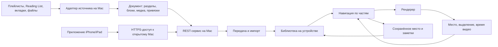

# FNMN: библиотека и читатель

FNMN — отдельный режим чтения для статей, видео и документов. Скрипты на Mac собирают и предварительно обрабатывают материал. Приложение на iPhone/iPad показывает его небольшими связанными частями, помогает продолжить и записать мысль у нужного места.

Сейчас приоритет у интерфейса библиотеки и просмотрщика: экраны, кнопки, поля, области поиска и добавление материалов с открытого Mac. Проект экранов находится в [design/library-ui.md](design/library-ui.md). Дальше по milestone в [очереди работ](tasks.md): плашки как единица текста, быстрое чтение, ИИ-разметка с мета-харнесом, переписывание, лента постов, адаптация и мультимодальность. [SPEC.md](../SPEC.md) хранит замысел ленты, но не задаёт текущие задачи.

Выбрано: iOS/iPadOS 27, SwiftUI, стандартные вкладки, списки, панели и листы. Текст, формулы, картинки и обычное видео читаются одним списком абзацев. WKWebView остаётся у интерактивной вставки. Оригинал открывается отдельным действием «Источник». Схема: [viz/reading.md](viz/reading.md).

[Архитектура текущего приложения](../APP_SPEC.md) · [Очередь работ](tasks.md) · [Полный список идей из Apple Notes](research/apple-notes-fnmn-source.md) · [Будущая учебная лента](../SPEC.md)

## Первый опыт

| Материал | Что видно в FNMN |
|---|---|
| Длинная статья | Оглавление → раздел → небольшая законченная часть. Выделение → заметка. |
| Видео YouTube | Потоковое видео и транскрипт, когда он доступен. Выбор синхронизированного фрагмента → соответствующее время видео. Без субтитров видео остаётся доступным. |
| PDF с доказательством | Раздел → текст, формула, следующий переход. Формула остаётся целой при переносах строк. |

Пользователь входит в небольшой фрагмент и при необходимости раскрывает родительский раздел. Исходный порядок и контекст доступны. Деление на части сохраняет содержание; смысловое сокращение и дополнительные объяснения являются отдельными операциями.

```text
Таб-бар: Library · Shelf · поиск
Library: Продолжить, Materials, папки
Читатель внутри Library: список абзацев, разделы, текст, источник
Shelf: заметки, выделения, прочитанное, почти прочитанное, архив
```

«Продолжить» возвращает к месту остановки. Предложение для первого «Далее»: материал выбирает пользователь, без автоматического ранжирования. Размер частей определяется структурой и смыслом, а не числом строк или произвольным лимитом символов.

## Путь содержимого



Адаптер получает исходник и превращает его в общий документ. Веб-страница и Substack читаются как статья. arXiv берётся из архива e-print. Пост X читается через oEmbed, публичный ChatGPT через JSON share. Неудачно обработанный материал остаётся задачей импорта с причиной ошибки. Ссылка сама по себе не означает готовность к чтению. Для видео требуется встроенное воспроизведение; отсутствие субтитров не блокирует просмотр. Позиция сохраняется при остановке, выходе и переходе приложения в фон. Реальную точность восстановления проверяют на плеере, а не только на сохранённом числе секунд.

Markdown хранит текст и формулы. Изображения, видео и интерактивные вставки представлены отдельными блоками или ресурсами. Оригинальный адрес сохраняется у документа, точные привязки — у его частей. Встроенное воспроизведение может требовать сети; просмотр внутри приложения не означает автоматически скачанное видео.

### Пакет PDF-книги

Проверенный пакет книги — каталог с `content.md`, `metadata.json`, `assets/` и `validation.json`, а не JSON `ImportPackage` статьи. `content.md` начинается с выбранного содержательного заголовка, сохраняет References, формулы, изображения и Markdown-сноски, но не содержит печатного Contents, Index, PDF-маркеров страниц, номеров заголовков и лишних пустых строк между страницами. `metadata.json` версии схемы 1 хранит название, подзаголовок, авторов, участников, язык, имя исходника, относительные пути и иерархическое оглавление. Каждая запись `toc` содержит порядковый номер, уровень Markdown и отображаемый заголовок.

Приложение копирует весь каталог в свою библиотеку только после проверки пустого массива `validation.json.errors`, а затем читает название и авторов из метаданных, строит навигацию по `toc` и открывает `content.md` тем же списком абзацев, что статью. Формулы рисует SwiftMath, изображения берутся относительно каталога книги. Сноска остаётся текстом Markdown в этом списке. Обработанный каталог неизменяем; другой результат разбора создаёт новую книгу. Контракт, экспортёр и проверочный образец находятся в [`server/pdf-book/`](../server/pdf-book/README.md) и [`fixtures/books/principles-of-deep-learning-theory/`](../fixtures/books/principles-of-deep-learning-theory/).

## Доставка между Mac и приложением

Связь должна работать с включённым и выключенным VPN на телефоне, без прежнего VPN VPS и нового платного хостинга. Первый кандидат для проверки — Tailscale Funnel: Mac публикует локальный REST-сервис по обычному постоянному HTTPS-адресу, доступному телефону без Tailscale-клиента. Адрес публичен и полоса ограничена, поэтому API должен проверять отдельный токен, а реальную передачу пакета надо проверить с телефона в обоих состояниях VPN. Mac при этом включён и не спит. Частный Tailscale Serve остаётся вариантом, только если допустимо переключать VPN на телефоне. [Условия и альтернативы](research/remote-mac-access.md).

```text
iPhone/iPad → публичный HTTPS-адрес Funnel → REST-сервис на Mac
```

Обработчик, исходные PDF и готовые пакеты остаются на Mac. Когда Mac недоступен, подготовка новой ссылки останавливается с понятным сообщением, а уже импортированная библиотека читается с телефона. Текущий API принимает URL, возвращает готовый пакет и проверяет отдельный bearer-токен также на `/health`; загрузка исходного PDF с телефона ещё требует контракта. [Проект экранов](design/library-ui.md) отделяет настройки Mac от формы добавления. [Пробный запуск Funnel](../server/funnel.md) использует CLI без изменения системного VPN на Mac.

## Один владелец каждого поведения

Предложение: модули внутри приложения и отдельный исполнитель обработки на Mac. Отдельные сетевые микросервисы для навигации и рендеринга добавили бы транспорт и согласование версий. Локальность кода обеспечивается владельцами поведения и небольшими контрактами.

| Место реализации | Обязанность | Пример локальной правки |
|---|---|---|
| Один файл на адаптер | Доступ, извлечение, особенности источника, общий документ на выходе | Изменился формат транскрипта |
| `Document` | Общие типы разделов, блоков, медиа и привязок | Появился новый вид блока |
| `Library` | Импорт, хранение, запросы, заметки и места чтения | Изменился способ сохранения |
| `Reader` | Выбор части, оглавление, переходы, продолжение, действия читателя | Иначе работает переход к следующему разделу |
| Один список абзацев | Текст, формула, картинка, видео-файл, живой кадр | Иначе отображается формула или видео |
| Одна операция преобразования | Конкретное объяснение с контекстом и проверкой | Иначе объясняется член формулы |

Имена обозначают обязанности будущего кода. Внутренние функции и типы остаются рядом с поведением, которому нужны. Отдельный слой для каждого шага «загрузить → распарсить → преобразовать» не требуется.

Разделение документа выполняется при подготовке. `Reader` перемещается по готовой структуре, а рендерер показывает выбранную часть. Изменение навигации не требует повторно извлекать транскрипт.

```text
adapter.prepare(source) → ImportPackage
library.import(package) → ImportResult
reader.open(itemID) → ReadingState
reader.update(event) → ReadingState
renderer.show(document, position) → события выделения и положения
```

Правило изменения: одно поведение имеет одного владельца. Новый адаптер обычно требует своего файла и регистрации. Новый общий тип содержимого требует согласованной правки контракта и его потребителей; обещание одной правки здесь было бы неверным.

## Минимальные данные

| Значение | Что хранит |
|---|---|
| Материал | ID, название, оригинальный адрес, ключ источника, исходные подборки |
| Документ | Редакцию, иерархию разделов, блоки с устойчивыми ID, ресурсы |
| Место | Документ и блок с текстовым смещением либо время видео |
| Чтение | Последнее место и открытие, явную отметку прочтения |
| Заметка | Текст, материал и необязательное выделение или время |

Повтор импорта не создаёт копии. Адаптер определяет идентичность: у YouTube это ID видео, у статьи правило адреса задаётся отдельно. Одно видео может принадлежать нескольким подборкам. Общий импортёр не удаляет параметры адреса наугад.

Заметка привязана к исходному фрагменту, поэтому изменение размера шрифта не сдвигает её смысл. Новая обработка сохраняет прежнюю редакцию до проверки переноса привязок. Прочтение не означает понимания; для первого опыта предлагается явная отметка пользователя.

## Порядок разработки

| Шаг | Конкретный результат | Проверка |
|---|---|---|
| 1. Один источник | Скрипт на Mac → обработанный пакет одной статьи | Есть заголовки, части, формула, изображение и исходные привязки |
| 2. Один читатель | Импорт → часть статьи → заметка → продолжить | После перезапуска открывается прежнее место и доступна заметка |
| 3. Видео | Встроенное видео и обработанный транскрипт | Переход текст → время, заметка к отрезку и восстановление позиции |
| 4. Библиотека | Reading List, вкладки, плейлисты, Watch Later, Share to FNMN | Каждый адаптер проверен на реальных данных и повторном импорте |
| 5. Удобство | Оглавление, настройки чтения, закладки, sidenotes, поиск | Привязки сохраняются после изменения представления |
| 6. Постоянное использование | Автоимпорт, CloudKit, категории, семантический поиск | Проверены два устройства, отсутствие Mac и работа с локальным содержимым |
| 7. Будущее: понимание | Преобразования, объяснения и визуализации | Оригинал доступен, условия и формулы сохранены |
| 8. Будущее: учебная лента | Короткие факты, треды, задачи, реакции и адаптация | Посты связаны с исходниками, исправление помогает следующему объяснению |

Первый полный проход — статья: обработка на Mac, разделы и подразделы, чтение внутри приложения, заметка и восстановление места. Массовый перенос существующей библиотеки YouTube исследуется параллельно: около 5000 видео в Watch Later и другие плейлисты. Нужен пакетный экспорт или автоматизированное получение, без копирования каждой ссылки отдельно.

Первый проход сохраняет исходные заголовки и абзацы. Он не делит текст моделью и не переписывает смысл. Точный исходный URL служит ключом повторного импорта статьи; дополнительные правила объединения адресов потребуют отдельной проверки. Получение выполняется для явно переданного URL или списка, без обхода связанных страниц.

PDF-книга уже имеет проверенный внешний формат, образец и импорт каталога в библиотеку. Читатель не сводит книгу к JSON-блокам. `content.md` открывается тем же списком абзацев, что статья. SwiftUI владеет прокруткой, оглавлением и действиями.

Ссылка из Share и поле в приложении идут одним маршрутом. Источник определяется по адресу или типу файла: Web, arXiv, YouTube, X, Substack, ChatGPT, PDF. Текстовые источники сходятся в пакет с названием, автором, ссылкой и Markdown с LaTeX. YouTube сходится в пакет с роликом и подписями по времени на Mac: yt-dlp забирает название и текст подписей, телефон только играет embed. Папки после подготовки отмечает человек. Сайт без статьи и страница, которую Mac не может прочитать, не становятся пустыми карточками. Живой разбор веб-статьи уже отдаёт Markdown в `body`. Старая функция `prepare_article` ещё собирает HTML-блоки и тестами держится как прежний контракт. Читатель её не использует, если в пакете есть `body`.

## Проверить до обещания импорта

| Источник | Ограничение |
|---|---|
| Плейлисты YouTube | Обычные пользовательские плейлисты доступны через API с авторизацией. [Метод](https://developers.google.com/youtube/v3/docs/playlists/list). |
| Watch Later | Data API не предоставляет список. Нужен отдельно проверенный путь получения. [Ограничение](https://developers.google.com/youtube/v3/docs/playlistItems/list). |
| Транскрипты | Официальный `captions.download` требует права редактирования видео. Чужое видео читает Mac через yt-dlp и `yt-dlp-ejs` 0.8.0. На «Me at the zoo» пришли английские реплики со временем. |
| Safari Reading List | `~/Library/Safari/Bookmarks.plist`, узел `com.apple.ReadingList`; локальное чтение проверено на 272 ссылках. Экспорт: [`server/collect/browser_links_export.py`](../server/collect/browser_links_export.py). [SSReadingList](https://developer.apple.com/documentation/safariservices/ssreadinglist). |
| Dia bookmarks | `~/Library/Application Support/Dia/User Data/Profile */Bookmarks` содержит JSON с папками. Имена профилей берутся из `Local State`. [`browser_library.py`](../server/collect/browser_library.py) берёт `Study/Theory Sources`, `Study/Theory Videos` и `Personal/UX/UI` один раз, так как Dia синхронизирует дерево между профилями. Итог объединяет одинаковые URL и сохраняет все места в `saved_in`. |
| Вкладки и группы Dia | `tabs.db` и `live_data_database.db` в профилях не открываются как обычная SQLite база. Файловый экспорт групп пока не подтверждён. |
| Вкладки других браузеров | Расширения дают поддерживаемый путь. Возможность первого скрипта проверяется для конкретного браузера. [Safari](https://developer.apple.com/documentation/safariservices/sfsafariwindow), [Chrome](https://developer.chrome.com/docs/extensions/reference/api/tabs). |

Скрипты читают исходные подборки, сохраняя их без изменений. Передача первого обработанного пакета через системный импорт файла предлагается как первый проверяемый путь; автоматическая передача определяется следующим шагом.

## Остальные идеи сохранены

| Когда | Что входит |
|---|---|
| Читатель и библиотека | Pinch к оглавлению, скрытие предложений, поля, звёзды, удаление, ручная коррекция категорий. Размер текста и фон уже в панели читателя |
| Захват и действия | Share to FNMN, Send to ChatGPT/Claude/Gemini, проверка ChatGPT Projects, App Intents |
| Объяснения | Editing Ontology v0.1, независимые настройки длины и сложности, полный окружающий контекст, проверки F01–F10, оригинал по одному действию |
| Лента и обучение | Маленькие факты → связующие объяснения, точные источники, HTML/SwiftUI-визуализации и формулы, подзадачи с разными полями ответа |
| Адаптация | Сократические вопросы, типы реплик преподавателя, реакции и self-improving meta-harness |

Полная онтология и все типы реплик сохранены в [исходном разделе](research/apple-notes-fnmn-source.md). Для первой операции выбирается один пример, а не реализуется сразу весь каталог. Если полный контекст не помещается в модель, способ обработки согласуется отдельно. Автоматическая проверка смысла не заменяет сверку с оригиналом.

## Как писать код

Порядок один и тот же; артефакт каждого шага проверяют следующий агент и владелец. Полный текст правил в [AGENTS.md](../AGENTS.md).

| Шаг | Что делается | Артефакт |
|---|---|---|
| 1. Вход | Одна задача из очереди с видимым результатом и проверкой | [tasks.md](tasks.md) |
| 2. Воспроизведение | Ошибка начинается с падающей проверки; функция — с проверки приёмки | тест, тест по исходникам или замер |
| 3. Проект | Кто владеет состоянием, какая у него форма, что меняется в контракте; `architect` для структурной правки | APP_SPEC.md в том же коммите |
| 4. Реализация | Наименьшая правка в существующих формах | код и тесты |
| 5. Защита | Самый сильный уровень, который видит весь класс ошибки; проверка падает без правки | тест, lint или diff; строка в реестре |
| 6. Проверка | `python3 scripts/guards.py --app`; ручная проверка на устройстве для ощущения | зелёный прогон |
| 7. Запись | История коммита; PR с what/why/guard/proof/not-in; задача закрыта | PR и tasks.md |

Правило защиты: проверка стоит на уровне, который видит класс ошибки, а не строку, где она случилась. Diff видит только добавленные строки, поэтому не может быть единственной защитой поведения или взаимодействия. Перед PR проверка доказывается: с откатом правки она падает. Одна ошибка — одна проверка в одном месте, второй копии нет.

Скиллы `software-developer` и `coding` читаются до первой правки, `architect` — до структурной. Их нет в каталоге скиллов агента, поэтому файлы открываются по путям из AGENTS.md. Платформенные скиллы подключаются по задаче. `principle-prove-it-works` проверяет настоящий пакет, восстановленное место и сохранённую заметку; компиляция подтверждает только компиляцию. GUI — только по прямой просьбе. После крупного блока — `two-pass-review`, к текстам — `unslop`.

## Открытые решения

- Проверить Tailscale Funnel с мобильной сети при включённом и выключенном VPN на iPhone, включая авторизацию и размер реального пакета. Клиент сохраняет HTTPS-адрес и токен между запусками; локальный сервис уже проверен с токеном. [Другие варианты подключения](research/remote-mac-access.md).
- Установлены Xcode 27.0, iOS SDK 27.0 и Swift 6.4. Сборка и тесты выполняются для выбранной версии 27. Проект телефона — `App/FNMN.xcodeproj`; для установки на устройство в Signing & Capabilities выбери свою Team для FNMN, Share и Activity.
- Качество встроенного YouTube не переключается: IFrame больше не применяет выбранный уровень. Переключателя нет. Пропуск рекламы не исследован.
- Проверить извлечение arXiv из LaTeX с изображениями и формулами, а DjVu — из текстового слоя либо через OCR для сканов.
- Уточнить «TypeSafe Jev API», способ классификации и применение Foundation Models, Core ML или Core AI к конкретным операциям.
