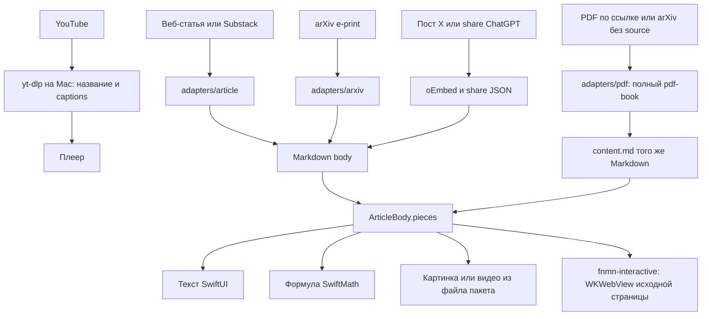

# Чтение: один документ, один список абзацев

Адаптер на Mac знает свой источник. На устройство приходит один Markdown. Список рисует его нативно. `WKWebView` остаётся только у живого кадра, который нельзя пересказать текстом.



Куски списка, сверху вниз:

```text
абзац: текст и $inline$
$$
display
$$
картинка-файл
видео-файл
живой кадр
```

Одна библиотека. Папки открываются отдельным списком: плюс создаёт папку алертом, долгое нажатие переименовывает. Добавление сначала показывает прогресс, и только потом человек отмечает папки. Документ без отмеченной папки остаётся в Materials.

Книга и статья отличаются только тем, откуда берётся Markdown. Сохранённое место у обоих — `piece:<index>` абзаца у верхнего края. Оглавление книги и статьи находит заголовок и прокручивает список к его абзацу. Старые `toc:<ordinal>` и id блока при открытии переводятся в такой абзац.

Список, таблица и цитата в одной ячейке Markdown пока рисуются построчно, без отдельного вида списка. Формула, которую SwiftMath не разобрал, остаётся исходным LaTeX. Прогресс пишется в Continue. Вкладка Shelf держит заметки, выделения, явно прочитанное, почти прочитанное и архив. Поиск это системная вкладка таб-бара. Выделение текста вызывает системное меню Highlight и подпись. Старый `prepare_article` ещё отдаёт HTML-блоки без `body`. Это не второй читатель: список берёт `body`, а если его нет, собирает текст из блоков.
